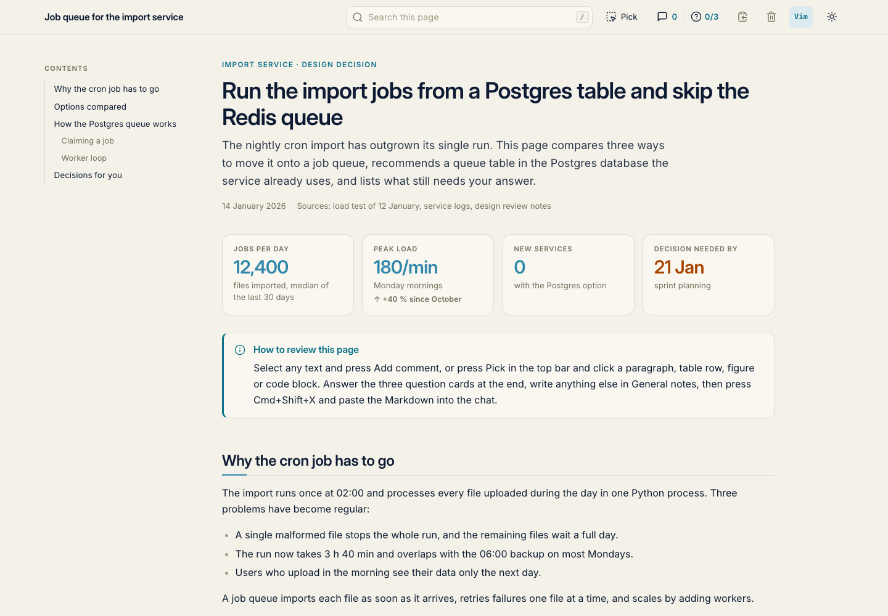
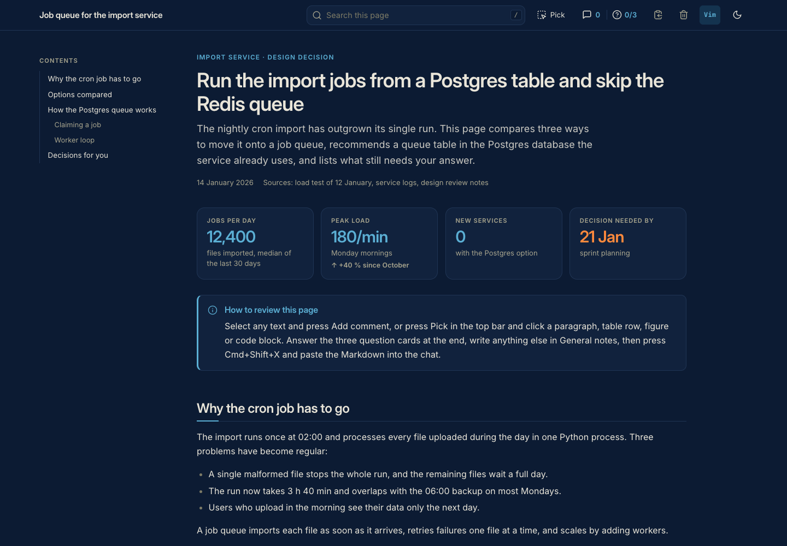
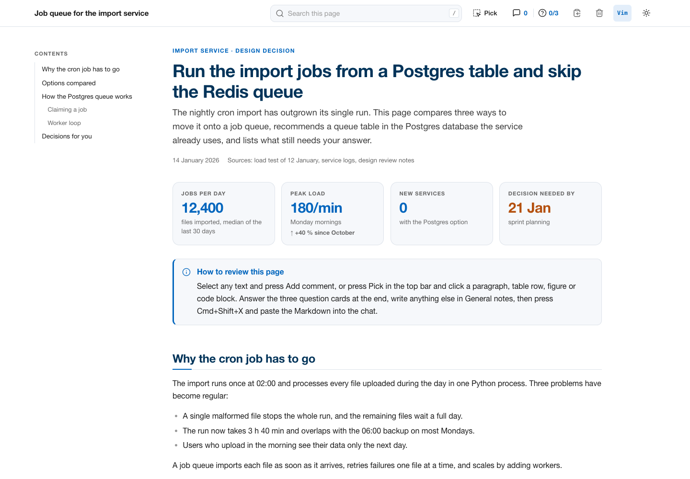
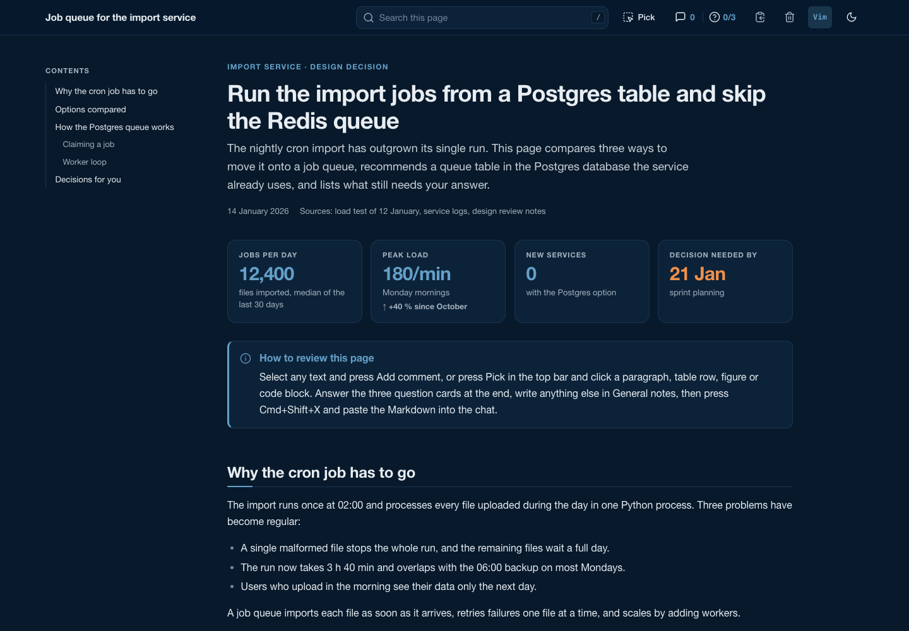
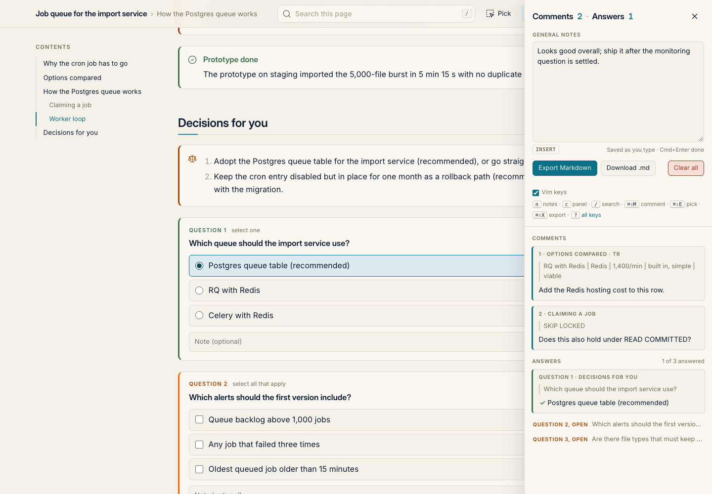

# report-html

A self-contained HTML page template for long agent answers, with a review layer in the browser.
The agent writes the report as plain semantic HTML; the reader comments on text or whole elements, answers question cards, writes general notes, and exports everything as Markdown to paste back into the chat.
It has light and dark modes, page search, a live outline, collapsible sections, figures that enlarge on click, and change marks since the last read.
It needs no build step, no network and no dependencies: one stylesheet, one script, and the page.



Two themes ship: the default (warm paper and navy, Inter fonts) and TUM (TUM corporate colours, Helvetica or Arial).
Both have a dark mode.

| Default, dark | TUM, light | TUM, dark |
|---|---|---|
|  |  |  |

## Files

- `report.html`: the skeleton to copy, about 50 lines.
- `example.html`: a filled demo, a made-up design decision that uses every component and three question cards.
- `report.css`: tokens, components, print styles and the embedded Inter fonts (about 270 KB, almost all fonts).
- `theme-tum.css`: the TUM theme, a token override linked after `report.css`.
- `report.js`: all behaviour, attached on load to plain markup.
  The page loads it from `<head>` without `defer`, so the stored light or dark mode applies before the first paint.
- `bundle.py`: inlines the stylesheets and the script into one file for sharing (Python 3, standard library only).
- `bin/report`: optional helper that creates a page from the skeleton and opens it (Python 3, standard library only).
- `screenshots/`: the demo in both themes and the comment panel.

## Install

Clone or copy this folder anywhere, for example `~/code/agent-setup/report-html`.
Open `example.html` in a browser to see it work.

Optionally put the helper on the `PATH`:

```bash
ln -s ~/code/agent-setup/report-html/bin/report ~/.local/bin/report
```

It finds the template through its own location; set `REPORT_HTML_DIR` when the script moves elsewhere.

## Make a page

With the helper:

```bash
report new path/to/2026-01-14_queue-decision.html --title "Job queue for the import service"
report new path/to/page.html --theme tum     # or set REPORT_THEME=tum
report open path/to/page.html
```

`report new` copies the skeleton, sets `<title>`, the h1 and `data-doc-id` (default: the file stem, `--id` for another slug), and points the stylesheet and script links at the template folder by absolute `file://` URL, so the page works from any folder.
`report open` opens the page in the default browser, in the background on macOS.

By hand:

1. Copy `report.html` to where the work lives, named `YYYY-MM-DD_<slug>.html`.
2. Replace the three asset paths in `<head>` (`report.css`, `theme-tum.css`, `report.js`) with absolute `file://` URLs of this folder, or keep the page next to the template files.
3. Set `<title>`, the h1 and `data-doc-id`.
4. Replace everything inside `<main>` with the content, and open the file in a browser.

Comments and answers are stored in the browser's localStorage under `data-doc-id`, so they survive a rename or a move of the file.
Keep `<title>` short, since the top bar shows it.
Leave the `<link>` and `<script>` lines as they are and add no extra `<style>` or `<script>`.
Adding `defer` to the script tag brings back a flash of the system colour scheme on load.

The page needs nothing else: no header, no outline markup, no wrapper divs, no ids.
Headings get ids from their text, tables get their frame, and code blocks get a Copy button at load time.

## Pick the theme

The default theme lives in `report.css`.
For the TUM theme, add one line after the `report.css` link:

```html
<link rel="stylesheet" href="report.css">
<link rel="stylesheet" href="theme-tum.css">
```

The skeleton and the demo carry that line commented out; uncomment it to switch.
`theme-tum.css` overrides only the CSS custom properties that `report.css` defines (colours, fonts, shadows), in light, dark and print.
Status colours that carry small text are darkened or lightened versions of TUM palette colours, to keep a 4.5:1 contrast.
TUM's own typeface is not free, so the TUM theme uses Helvetica Neue, Helvetica or Arial, whichever the system has.

A new theme is another `theme-<name>.css` with the same token list; `bundle.py` inlines any linked `theme-*.css`, and `bin/report` needs one entry in its `THEMES` table.

## Share a page

The `file://` links resolve only on the machine that has the template.
For anyone else, bundle the page into one file that carries the stylesheets, script and fonts inline:

```bash
python3 bundle.py page.html -o page.standalone.html
```

Without `-o` the output goes next to the page as `<name>.standalone.html`.
The script reads each linked asset from its path, or from its own folder when that path does not exist, and drops commented-out asset links.

## Use it from an agent

This block goes into a skill or `AGENTS.md`, with the path adjusted:

```markdown
## HTML reports

Anything longer than a short chat answer (tables, figures, several questions, a concept to explain) goes into an HTML report page, never a long Markdown reply.
Read `<path-to>/report-html/README.md` once, then create the page with `report new <dir>/YYYY-MM-DD_<slug>.html --title "..."` (add `--theme tum` for the TUM look).
Write only the content inside `<main>`: plain semantic HTML plus the classes listed in the README (callouts, badges, key figures, figures, question cards).
Ask every question you need answered as a question card, with the options, their trade-off and a recommendation.
Run `report open <path>` and give the user the path.
The user comments in the page and pastes the exported Markdown back; each comment names its section and quotes the text or gives a CSS selector of the element.
Revise the same file in place and remove the question cards that are answered; the page clears the exported comments on its next load once its `<main>` content has changed, and marks what changed since the last read.
To share a page outside this machine, run `python3 <path-to>/report-html/bundle.py <page>`.
```

## Content conventions

- Start with `p.eyebrow` (project and kind of report), one `h1` that states the finding, `p.lede`, and `p.meta` holding `<span>` items such as the date and the sources.
- Use `h2` for sections and `h3` for subsections; the outline is built from them.
  Headings inside callouts, cards, figures, key-figure cards, question cards and `details` stay out of the outline, as does any heading with class `bn-notoc`.
- Write plain `<table>` markup.
  A first row of `<th>` becomes a sticky header, rows are zebra-striped, and a table too wide for the column scrolls sideways inside a frame.
  Use `td.num` for right-aligned figures and `td.nowrap` for identifiers.
- Write code blocks as `<pre data-lang="bash"><code>...</code></pre>`; `data-lang` is optional.
- Use `.grid-2` or `.grid-3` for side-by-side columns, `.card` for a plain panel, `dl.fields` for label and value pairs, `details` for collapsible material, `blockquote` with a trailing `span.src` for quoted sources, and `p.src` for a source line under a block.

## Components

- Callouts: `<div class="callout note|warning|decision|success">` with an optional `<p class="callout-title">`.
  `warning` covers deadlines and risks, `decision` covers what the reader has to decide, `note` covers context and caveats, and `success` covers what is done.
  A `decision` callout holding an `<ol>` lists several decisions, each with its recommendation.
- Badges: `<span class="badge ok|info|warn|danger|neutral|accent">label</span>`; add `plain` to drop the dot.
  Use `ok` for done, `info` for in progress or with the agent, `warn` for waiting or at risk, `danger` for blocked or overdue, `neutral` for parked or later, and `accent` for anything that needs the reader.
- Key figures: a `div.kpis` holding `div.kpi` cards, each with `span.kpi-label`, `span.kpi-value` and an optional `span.kpi-note` or `span.kpi-delta up|down`.
  `.kpi.accent` sets one value in the accent colour, for the single figure that needs attention.
- Figures: `<figure class="fig">` around an `` (a `data:` URI keeps the page portable) or an inline `<svg>` with a `viewBox`, plus a `<figcaption>`.
  Figures are numbered automatically and enlarge on click; `fig bare` drops the frame.
  Inline SVG can use the page tokens, for example `fill="currentColor"`, `fill="var(--surface)"` or `stroke="var(--ocean)"`, so it follows the theme and the dark mode.

### Question cards

A question card asks the reader something the agent needs decided; the answer travels with the export.

```html
<div class="question" data-id="queue-choice" data-type="single">
<p class="q-text">Which queue should the import service use?</p>
<ul>
  <li data-value="postgres">Postgres queue table (recommended)</li>
  <li data-value="rq">RQ with Redis</li>
</ul>
</div>
```

`data-type` is `single` (radio buttons), `multi` (checkboxes) or `text` (a free-text box, no list).
`data-id` is the stable key the export reports, and `data-value` on an option is optional.
Choice questions also get an optional note field.

## Review round trip



1. The agent writes the page, with question cards for anything it needs decided, and hands over the path.
2. The reader comments, answers the cards, and writes general notes in the comment panel.
3. Cmd+Shift+X, the clipboard button in the top bar or Export Markdown in the panel copies the result; the reader pastes it into the chat.
   When the clipboard is blocked, the top bar button downloads the file instead, and the panel offers Download .md.
4. The agent revises the same file in place, removes the answered question cards, and hands the path back.
5. On the next load the page sees that its content changed and clears what the last export carried.
   The bin button in the top bar or Clear all in the panel wipes everything at any time, after a confirmation dialog.
6. The revised page marks what changed since the exported version and folds the unchanged sections.

Ways to comment:

- Text: select any text, then press Add comment or Cmd+Shift+M.
- Element: press Pick in the top bar or Cmd+Shift+E, then click a paragraph, list item, table cell or row, table, heading, figure, code block, callout, card or key figure.
  The arrow keys widen the pick to the enclosing element and back, Enter or a click opens the comment box, and Esc leaves pick mode.
- General notes: the text box at the top of the panel, for anything not tied to one place; `n` opens it.

Cmd+Enter (or Ctrl+Enter) saves a comment and closes its box.
Clicking a highlight, a badge or an entry in the panel reopens it for editing or deletion.

The export lists the page title and file path, the general notes, the comments in document order, and one answer per question card (its `data-id`, the question, the choice or text, and the note).
Each comment quotes the selected text or the first 120 characters of the element; an element comment adds a CSS selector such as `main > table > tbody > tr:nth-of-type(3)`, written against the page source.

### Review rounds

At load, `report.js` hashes the source of `<main>`; that hash is the page revision.
A successful export records a snapshot of what it carried.
When the page loads with a different revision, it removes every comment and answer still identical to the snapshot, and the exported notes.
Anything added or edited after the export stays, so feedback written while the agent works is never lost.
A toast names what was cleared, and Restore cleared round in the panel brings it back.
The snapshot and the archive sit in localStorage under `anno:<doc-id>:round` and `anno:<doc-id>:prev`.

### Changes since the last read

The browser keeps the text of the version the reader last read, and a revised page compares itself against it at load.

- The unit is the block: heading, paragraph, list item, table row, code block, quote, caption, `summary`, key figure, callout or card.
- Inside a changed block, added words are highlighted in green and removed words sit inline, struck through in red.
  A changed or new block gets a bar in the left gutter; removed blocks show as a red minus chip that reveals their text on click.
- The outline shows a change count per section, and sections without any change collapse on load.
- The top bar shows the change count (`d` toggles the marks), arrows to step through them (`]` and `[`), and a button that marks the version as read.
- A version counts as read on a successful export or on Mark read.
  The first visit stores the page as the baseline and marks nothing.
- The baseline sits in localStorage under `bn-read:<doc-id>`; `bn-read-lru` keeps the 40 most recently opened pages, since Chrome shares one storage across all `file://` pages.
  Firefox keeps a separate storage per `file://` page, so there a copied or renamed page starts from scratch.

### Shortcuts

Single keys work only while no text box has focus.

- `n`: open the panel with the cursor in General notes.
- `c`: open or close the panel.
- `/`: focus the search.
- `?`: list every shortcut.
- `]` and `[`: next or previous change since the last read; `d`: show or hide the change marks.
- Cmd+Shift+M: comment on the selected text.
- Cmd+Shift+E: start or leave pick mode.
- Cmd+Shift+X: export as Markdown to the clipboard.
- Cmd+Enter: save a comment, or leave the general notes or an answer box.
- Esc: leave pick mode, the search, a comment box or the panel.

A small Vim mode works in the comment, notes and answer boxes; the Vim button in the top bar switches it, and the browser remembers the setting.

## Reading it

- The page follows the system light or dark setting; the sun and moon button switches mode and remembers the choice.
  `?theme=dark` or `?theme=light` in the URL forces a mode without storing it, which is how the screenshots were taken.
- `/` focuses the search; Enter and Shift+Enter step through the matches, matching ignores case and accents, and the funnel button hides table rows and question cards without a match.
- The outline highlights the current section; below 1100 px it collapses into a button in the top bar.
- Every h2 and h3 collapses with a chevron in the left gutter; Alt+click collapses or expands every section at that level.
- Printing drops the top bar, outline, search and every comment and change mark, prints collapsed sections expanded, keeps the answered question cards, and prints in the light palette.

The page exposes `window.bn.review` (export, comments, answers, notes), `bnFold` and `bnChanges` for tests and for agents that drive the page headlessly.

## Fonts and licence

The default theme embeds Inter Regular and SemiBold and Inter Display SemiBold as Latin-subset woff2 in `report.css`.
Inter is copyright The Inter Project Authors and licensed under the SIL Open Font License 1.1 (https://github.com/rsms/inter).
Characters outside the subset fall back to the system sans-serif font, and code uses the system monospace font.
The template itself is under the MIT licence of this repository.
